  

 

Oi, eu sou o Warley. Por aqui, costumo usar **Zythenth**.

Gosto de pegar uma ideia solta e descobrir até onde ela pode ir. Às vezes ela vira um bot para Discord. Em outras, vira um motor de RPG, uma automação ou alguma ferramenta pequena para resolver uma tarefa que estava me incomodando.

Programo principalmente com Python e TypeScript. Também gosto muito de RPG, sistemas cheios de regras e projetos que misturam código com IA sem entregar toda a lógica para o modelo.

Quando não estou tentando fazer algo novo, provavelmente estou refazendo alguma parte até ela ficar do jeito que imaginei.

> **Agora:** Black Gravity · **Linguagens:** Python e TypeScript · **Gosto de:** RPG e sistemas cheios de regras

 

  
  
  
  

 

**[Black Gravity](https://github.com/Zythenth/black-gravity)** é um servidor MCP local que delega tarefas de programação ao Google Antigravity pelo CLI oficial `agy`. Cada tarefa roda numa cópia isolada do projeto e só chega ao código original depois de verificada e revisada. É feito com TypeScript e Node.js.

**[Aurora](https://github.com/Zythenth/aurora-discord-bot)** nasceu da minha vontade de criar algo especial e de um impulso que veio do amor da minha vida. O que começou como uma ideia simples foi crescendo até se tornar um bot com roleplay, afinidade, privacidade, moderação e integração com GIFs. Ele é feito com TypeScript, Discord.js, Prisma e SQLite.

**[Chronos](https://github.com/Zythenth/Chronos-RPG-Engine-v4.0)** nasceu porque eu queria um RPG diferente, com mais liberdade para explorar uma história sem deixar as regras de lado. Nele, o Python cuida do mundo e das consequências enquanto o Gemini ajuda a contar a história.

**[Anti-AI Craft](https://github.com/Zythenth/anti-ai-craft)** reúne algumas das regras que tento seguir quando trabalho com IA. O foco é evitar código genérico, decisões sem evidência e mudanças feitas só porque parecem convenientes.

 

  

Além dessas ferramentas, trabalho com Discord.js, Prisma, APIs REST, MCP, testes automatizados e integração com modelos de linguagem.

 

  
  

  

 

Estou aberto a trabalhos pequenos e bem definidos envolvendo bots, automações, integrações e correções em Python ou TypeScript.

  
  

